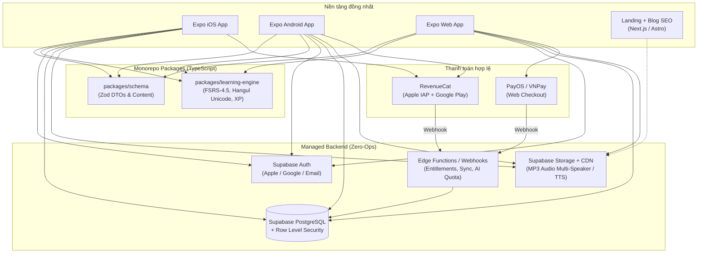
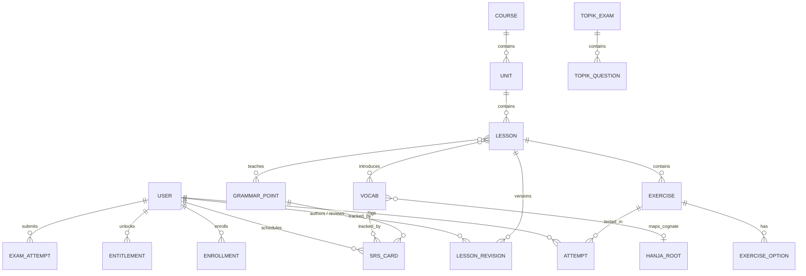

# SEED — Project Audit & Unified Target Architecture (iOS / Android / Web)

> **Tình trạng tài liệu:** Phân tích dựa trên kiểm tra mã nguồn tĩnh của 2 kho lưu trữ cũ (`seed-flutter-1` và `seedbutpretty`) tại commit mới nhất. Chưa thực hiện build hay chạy runtime.

---

## 1. Cảnh báo bảo mật khẩn cấp (Hành động ngay)

Kho lưu trữ `seedbutpretty` đang ở chế độ **public** và commit `f05a3d7` chứa tệp `.env` đã được đưa thẳng lên Git:
- `CLERK_SECRET_KEY` (`sk_test_...`)
- `NEXT_PUBLIC_CLERK_PUBLISHABLE_KEY` (`pk_test_...`)
- `DATABASE_URL` (chuỗi kết nối PostgreSQL Neon kèm mật khẩu)

**Quy trình xử lý bắt buộc (không chỉ xóa file ở commit mới):**
1. **Clerk Dashboard:** Rotate/thu hồi `CLERK_SECRET_KEY` cũ ngay lập tức.
2. **Neon Console:** Đổi mật khẩu role database hoặc xóa project cũ nếu không còn dữ liệu cần giữ.
3. **GitHub:** Chuyển cả hai repo về `Private` (hoặc lưu trữ nội bộ), bật **Secret Scanning** và **Push Protection** cho repo mới.

---

## 2. Kiểm toán 2 kho lưu trữ cũ (Post-Mortem)

### 2.1 Bảng so sánh thực trạng

| Tiêu chí | `seed-flutter-1` | `seedbutpretty` |
|---|---|---|
| **Bản chất kỹ thuật** | **Không có Flutter/Dart.** Full-stack TypeScript (React 18 + Vite + Express + Drizzle) do Replit Agent tạo (~5.281 dòng TS/TSX ngoài `ui/`). | Next.js 14 App Router + Clerk + Drizzle + Neon Postgres. Fork từ template *lingo* (Duolingo clone). |
| **Lịch sử Git** | 31 commits (14/02/2025 → 18/04/2025). | 2 commits (13/12/2024). |
| **Lưu trữ dữ liệu** | `server/storage.ts` xuất `new MemStorage()` + `MemoryStore` cho session → **toàn bộ dữ liệu nằm trên RAM**, khởi động lại là mất sạch. Có `server/db.ts` (Neon) nhưng không nối vào `storage`. | Kết nối PostgreSQL thật qua Neon serverless driver, có foreign keys và `onDelete: 'cascade'`. |
| **Hỗ trợ Mobile** | Có `client/App.native.tsx`, `navigation.ts` và 3 screen (`HomeScreen`, `CoursesScreen`, `ProfileScreen`) nhưng **thiếu** `app.json`, Metro/Expo config, thư mục `ios/` và `android/` → không thể build/chạy trên điện thoại. | Chỉ chạy Web (có `manifest.webmanifest` dạng PWA cơ bản). |
| **Nội dung học tập** | Đúng domain tiếng Hàn cho người Việt (TOPIK I/II, từ điển Hàn–Việt–Anh, bài học freemium, giáo viên), nhưng nhồi cấu trúc vào cột `jsonb` thiếu kiểm soát. | Seed data (`scripts/seed.ts`) là tiếng Tây Ban Nha, Ý, Pháp, Đức — **chưa có tiếng Hàn**. Các trang `lesson`, `shop`, `quests` mới là placeholder (`
LESSON PAGE
`, `
SHOP
`). |

### 2.2 Danh sách lỗi bảo mật & logic nghiêm trọng trong code cũ

#### Trong `seed-flutter-1`
1. **Leo thang đặc quyền khi đăng ký (`server/auth.ts` L78–84):** Bất kỳ ai đăng ký với `email === "admin@seed-topik.com"` và `username === "admin"` đều tự động được gán `role = 'admin'` mà không qua xác minh email (tương tự với `teacher` và `manager`).
2. **Giáo viên tự duyệt bài (`server/routes.ts` L356–375 & `server/storage.ts` `updateLesson`):** `PUT /api/lessons/:id` truyền nguyên `req.body` vào `updateLesson`, hàm này trải `...lessonData` đè lên object bài học. Một tài khoản `teacher` có thể gửi `{ "status": "approved" }` để tự duyệt bài của chính mình.
3. **Lộ password hash (`server/auth.ts` L95, L100, L112 & `server/routes.ts` L440):** Các endpoint `/api/register`, `/api/login`, `/api/user`, `/api/admin/users` trả thẳng object `user` lấy từ storage, bao gồm cả trường `password` (hash scrypt). Ngoài ra `server/index.ts` còn log `capturedJsonResponse` ra stdout.
4. **IDOR trên tiến độ & phiên học (`server/routes.ts` L194–278):** Các route `GET /api/users/:userId/progress`, `GET/POST /api/users/:userId/study-sessions`, `POST /api/study-sessions/:sessionId/end`, `GET /api/users/:userId/achievements` không kiểm tra đăng nhập hay quyền sở hữu, mặc dù `server/permissions.ts` có viết sẵn `canViewUserProgress` nhưng không sử dụng.
5. **Giả mạo danh tính WebSocket & lỗi runtime (`server/routes.ts` L467–501):** Server tin tưởng tuyệt đối `data.userId` do client gửi qua gói tin `{ type: 'auth', userId }` mà không đối chiếu cookie session. Đồng thời file chỉ import `WebSocketServer` từ `ws`, nhưng dòng L493 lại gọi `WebSocket.OPEN` (Node 20 không có global `WebSocket` theo chuẩn `ws` server → suy luận sẽ văng `ReferenceError` khi broadcast).
6. **Route bị che khuất (Shadowed Routes) (`server/routes.ts`):** `/api/lessons/pending` (L399) khai báo *sau* `/api/lessons/:id` (L335); `/api/chat/unread-count` (L315) khai báo *sau* `/api/chat/:userId` (L281). Express khớp route động trước nên 2 endpoint sau không bao giờ chạy tới.
7. **Session secret mặc định & thiếu validation:** `SESSION_SECRET` có fallback chuỗi cứng trong code; hầu hết route POST/PUT không chạy `zod` schema dù đã định nghĩa trong `shared/schema.ts`.
8. **Crash process khi lỗi (`server/index.ts`):** Middleware xử lý lỗi gọi `throw err` sau khi đã gửi `res.status(status).json(...)`.

#### Trong `seedbutpretty`
1. **Ghi đè dữ liệu toàn bộ người dùng (`actions/selectCourse.ts`):** Câu lệnh `await db.update(userProgress).set(selection)` **thiếu mệnh đề `.where(eq(userProgress.userId, userId))`**. Khi một học viên chọn khóa học, toàn bộ các bản ghi trong bảng `user_progress` của **mọi người dùng** bị ghi đè `activeCourseId`, `userName`, và `userImgSrc`.
2. **Thiếu lõi thực hành:** `challengesEnum` mới chỉ có `['SELECT', 'HINT']`; trang làm bài, cửa hàng, nhiệm vụ chưa được cài đặt.

### 2.3 Tài sản nên giữ lại làm tham khảo
- **Từ `seed-flutter-1`:** Hệ thống phân quyền 6 cấp (`guest < user < paid_user < teacher < manager < admin` trong `permissions.ts`), luồng duyệt nội dung `pending -> approved/rejected` kèm `reviewNote`, định hướng nội dung riêng cho người Việt (từ điển Hàn–Việt–Anh kèm phiên âm, luyện thi TOPIK I/II, streak).
- **Từ `seedbutpretty`:** Cây dữ liệu chuẩn hóa (`courses → units → lessons → challenges → challenge_options`), trường `audioSrc`/`imageSrc` gắn ở mức lựa chọn đáp án, UI bản đồ học tập (UnitBanner, LearnButton với trạng thái Locked/Current/Active), thiết kế landing page và dark mode.

---

## 3. Kiến trúc mục tiêu cho Solo Founder (iOS + Android + Web đồng nhất)

Với bối cảnh **1 người phát triển cùng AI**, kiến trúc phải triệt tiêu chi phí vận hành hạ tầng (zero-ops), dùng chung 1 ngôn ngữ (TypeScript) và 1 bộ schema validation từ database tới UI.

### 3.1 Lựa chọn công nghệ

| Lớp | Công nghệ đề xuất | Lý do chọn cho mô hình Solo + AI |
|---|---|---|
| **Mobile + App Web** | **Expo (React Native) + Expo Router** (`react-native-web`) | Một codebase duy nhất build ra app iOS, Android và Web app (`app.seed...`). Tái sử dụng kỹ năng TS/React hiện có; chia sẻ trực tiếp `zod` schema và engine thuật toán FSRS; cập nhật nhanh qua EAS Build & EAS Update. |
| **Landing / SEO** | **Next.js hoặc Astro** (tách nhẹ thành `apps/landing`) | Expo Web mạnh cho ứng dụng sau đăng nhập, nhưng landing page và blog luyện thi TOPIK cần SSR/SSG để làm SEO. |
| **Backend & DB** | **Supabase** (PostgreSQL + Auth + Storage + Edge Functions) | Loại bỏ việc tự viết và bảo trì Express/Passport server; có sẵn Row Level Security (RLS), CDN cho audio/hình ảnh, và Auth (bắt buộc bật **Sign in with Apple** song song Google/Email theo quy định App Store). |
| **Monorepo** | **pnpm workspaces + Turborepo** | Chia package rõ ràng: `apps/mobile`, `apps/landing`, `packages/schema`, `packages/learning-engine`, `content/`. |
| **Thanh toán (Tuân thủ Store)** | **RevenueCat** (iOS IAP & Google Play Billing) + **PayOS / VNPay** (Web) | **Bắt buộc:** Apple Guideline 3.1.1 và Google Play Billing cấm bán gói thuê bao nội dung số qua cổng thanh toán bên thứ ba ngay trong app mobile. Cả 2 luồng đều đổ webhook về server/Edge Function để ghi bảng `entitlements` — client không bao giờ tự gán quyền `isPaid`. |

### 3.2 Sơ đồ tổng thể & Luồng dữ liệu

### 3.3 Mô hình dữ liệu chuẩn hóa (Core Schema)

**5 nguyên tắc thiết kế dữ liệu để tránh lỗi cũ:**
1. **Không nhồi dữ liệu chấm điểm vào JSONB:** Từ vựng, điểm ngữ pháp, câu hỏi và lựa chọn phải nằm ở các bảng quan hệ để truy vấn thống kê lỗi sai và đồng bộ SRS. JSONB chỉ dùng cho payload đặc thù từng dạng bài tập và bắt buộc có trường `schemaVersion` được kiểm bằng `zod`.
2. **Versioning nội dung (`lesson_revisions`):** Giáo viên sửa trên bản nháp (`draft` → `pending` → `approved`); bản đã `published` là bất biến (immutable) để không làm hỏng lịch sử làm bài của học viên đang học dở.
3. **Log làm bài bất biến & idempotent (`attempts`):** Lưu `client_attempt_id` (UUID sinh từ thiết bị). Khi app mobile học offline rồi có mạng đồng bộ lại, server dựa vào unique constraint trên `client_attempt_id` để chống ghi trùng XP và trùng lần ôn FSRS.
4. **Quyền lợi tách biệt (`entitlements`):** Bảng `entitlements` ghi nguồn (`apple_iap`, `google_play`, `payos`, `manual_grant`), `expires_at`, và `status`. Mọi kiểm tra khóa nội dung TOPIK/AI đều thực hiện ở Postgres RLS hoặc Edge Function.
5. **Quyền truy cập mặc định khép kín:** Bật RLS trên tất cả bảng người dùng (`srs_cards`, `attempts`, `entitlements`); người dùng chỉ đọc/ghi bản ghi có `user_id = auth.uid()`.
