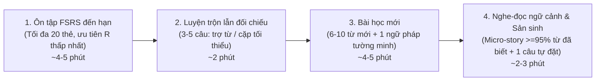
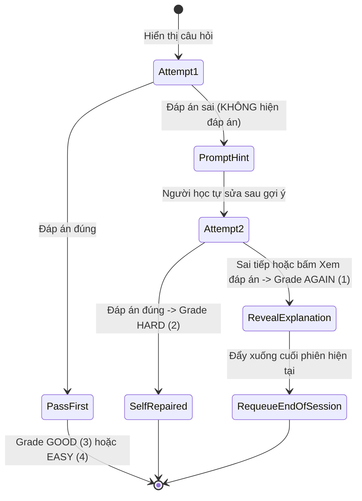

# SEED — Learning Design Spec (Đặc tả Thuật toán & Cơ chế Học tập)

Tài liệu này quy định **chính xác cách phần mềm vận hành** để hiện thực hóa các bằng chứng khoa học trong [02-scientific-foundation-and-pedagogy.md](file:///c:/Users/linhn/Downloads/SEED/docs/02-scientific-foundation-and-pedagogy.md). Mọi thông số, công thức và JSON schema dưới đây được kiểm chứng bằng script mô phỏng tại `scripts/validate-and-simulate.mjs`.

---

## 1. Cấu trúc một phiên học hằng ngày (10–15 phút)



**Luật bảo vệ chống "nhồi nhét":**
- Nếu số thẻ quá hạn (`Retrievability < 0.90`) vượt quá `25` thẻ, hệ thống khuyến nghị **Session Bảo trì** (chỉ ôn và trộn lẫn, tạm ẩn bài mới) để tránh nợ ôn dồn đọng.
- Giới hạn từ mới tối đa mỗi ngày mặc định: `10 từ` (có thể chỉnh `6 / 10 / 15` trong cài đặt).

---

## 2. Thang 4 nấc thành thạo từ vựng (4-Stage Mastery Ladder)

Dựa trên phân loại của Nakata (2011, 2019), mỗi thẻ từ vựng của người học lưu trạng thái `(stage, fsrs_state)`:

| Nấc | Tên gọi | Hướng & Loại truy xuất | Dạng bài tập được phép sinh | Điều kiện lên nấc |
|---|---|---|---|---|
| **Stage 1** | *Nhận diện thụ động* (Receptive Recognition) | Hàn / Audio → chọn nghĩa Việt | Nghe-chọn nghĩa, đọc-chọn nghĩa (nhiễu cùng chủ đề hoặc gần âm) | Trả lời đúng ngay lần đầu (`grade >= Good`) |
| **Stage 2** | *Tự nhớ nghĩa theo ngữ cảnh* (Receptive Recall / Cloze) | Thấy/nghe tiếng Hàn trong câu → nhớ nghĩa hoặc chọn đúng chức năng | Điền nghĩa tiếng Việt hoặc chọn đúng cặp từ trong câu ngắn | Đúng ngay lần đầu sau khoảng giãn cách $\Delta t \ge 1$ ngày |
| **Stage 3** | *Tái tạo có gợi ý* (Productive Recognition / Assembly) | Nghĩa Việt → lắp ghép âm tiết Hangul hoặc cụm từ + trợ từ rời | Ghép jamo thành âm tiết, ghép từ + chọn trợ từ (trợ từ tách rời!) | Đúng ngay lần đầu sau $\Delta t \ge 3$ ngày |
| **Stage 4** | *Sản sinh chủ động* (Productive Recall) | Nghĩa Việt + ngữ cảnh → tự gõ bàn phím Hàn (IME) hoặc nói từ trí nhớ | Tự gõ tiếng Hàn có kiểm tra chính tả `ㅐ/ㅔ`, patchim; tự gõ câu ngắn | Đạt trạng thái **Mastered (Thuộc thật)** khi đứng ở Stage 4 với FSRS Stability $S \ge 21$ ngày |

**Luật giáng nấc (Demotion on Lapse):**
- Khi người học quên hoàn toàn (`grade = Again`, sai cả 2 lần thử), `stage = max(1, stage - 1)`. Việc này đảm bảo nếu một từ Stage 4 bị quên mặt chữ, app tự lùi về Stage 3 để củng cố lại trước khi yêu cầu gõ lại.

---

## 3. Đặc tả thuật toán FSRS-4.5 (Free Spaced Repetition Scheduler)

SEED dùng mô hình **DSR** (Ye et al., KDD 2022 / FSRS-4.5) với mức duy trì mục tiêu mặc định $R^* = 0.90$ (90% xác suất nhớ tại thời điểm được gọi ôn lại).

### 3.1 Đường cong quên (Retrievability) & Khoảng cách ôn tiếp theo (Interval)
Tại thời điểm đã trôi qua $t$ ngày kể từ lần ôn gần nhất của thẻ có độ bền $S$ (ngày):

$$R(t, S) = \left(1 + \frac{19}{81} \cdot \frac{t}{S}\right)^{-0.5}$$

*(Khi $t = S$, ta có đúng $R(S, S) = (1 + 19/81)^{-0.5} = (100/81)^{-0.5} = 0.9$.)*

Khoảng cách ngày tiếp theo $I$ để đạt mục tiêu nhớ $R^*$:

$$I(S, R^*) = \max\left(1, \text{round}\left(\frac{81}{19} \cdot S \cdot \left((R^*)^{-2} - 1\right)\right)\right)$$

### 3.2 Điểm đánh giá tự động (Auto-Grading — Không bắt người dùng tự bấm Khó/Dễ)
Khác với Anki buộc người dùng tự chấm chủ quan, SEED ánh xạ hành vi làm bài thành 4 cấp điểm FSRS $G \in \{1, 2, 3, 4\}$:

| Hành vi làm bài trên 1 câu hỏi | Điểm FSRS ($G$) | Ý nghĩa |
|---|---|---|
| Đúng ngay lần 1 ở **Stage 4** trong $\le 4.5$ giây (không dùng gợi ý) | **4 — Easy** | Truy xuất sản sinh trôi chảy |
| Đúng ngay lần 1 ở bất kỳ Stage nào | **3 — Good** | Truy xuất thành công |
| Sai lần 1 → tự sửa đúng ở lần 2 sau khi đọc `promptHint` | **2 — Hard** | Nhớ nhưng cần gợi mở siêu ngôn ngữ |
| Sai cả lần 2 hoặc nhấn "Xem đáp án" | **1 — Again** | Quên (Lapse) — đưa vào ôn lại cuối phiên & giảm Stability |

### 3.3 Cập nhật trạng thái $(D, S)$ sau mỗi lần ôn
Sử dụng bộ trọng số mặc định chuẩn của FSRS-4.5 (`w[0..16]`):
- **Thẻ mới lần đầu ($t = 0$):**
  $$S_0(G) = w_{G-1}, \quad D_0(G) = \text{clamp}\left(w_4 - (G - 3) \cdot w_5,\; 1,\; 10\right)$$
- **Cập nhật Độ khó $D'$:**
  $$D' = \text{clamp}\left(w_7 \cdot D_0(3) + (1 - w_7) \cdot (D - w_6 \cdot (G - 3)),\; 1,\; 10\right)$$
- **Khi nhớ được ($G \in \{2, 3, 4\}$):**
  $$S' = S \cdot \left(1 + e^{w_8} \cdot (11 - D) \cdot S^{-w_9} \cdot \left(e^{w_{10} \cdot (1 - R)} - 1\right) \cdot k_{\text{hard/easy}}\right)$$
  trong đó $k = w_{15}$ nếu $G = 2$ (Hard), $k = w_{16}$ nếu $G = 4$ (Easy), $k = 1$ nếu $G = 3$ (Good).
- **Khi quên ($G = 1$ — Again):**
  $$S' = \min\left(S,\; w_{11} \cdot D^{-w_{12}} \cdot ((S + 1)^{w_{13}} - 1) \cdot e^{w_{14} \cdot (1 - R)}\right)$$

*(Tham số mặc định `w` được cài đặt đầy đủ và kiểm thử trong `scripts/validate-and-simulate.mjs`.)*

---

## 4. Cơ chế phản hồi sửa lỗi 2 bước (Prompt-First Engine)



**Yêu cầu dữ liệu bắt buộc:** Mọi bài tập trong SEED đều phải có đủ 2 trường:
1. `promptHint`: Gợi ý quy tắc hoặc manh mối phát âm/trợ từ bằng tiếng Việt (không lộ chữ đáp án).
2. `explicitExplanation`: Giải thích đầy đủ vì sao đáp án đúng + đối chiếu cặp lỗi thường gặp của người Việt.

---

## 5. Luật hình thái học Hangul xác định (Deterministic Korean Engine)

Thay vì dùng AI kiểm tra trợ từ, SEED tính toán xác định trực tiếp từ mã Unicode của ký tự Hangul cuối cùng (`0xAC00` – `0xD7A3`):

```ts
export function hasBatchim(koreanWord: string): boolean {
  const trimmed = koreanWord.trim();
  const lastChar = trimmed[trimmed.length - 1];
  const code = lastChar.charCodeAt(0);
  if (code < 0xAC00 || code > 0xD7A3) return false;
  return (code - 0xAC00) % 28 !== 0;
}

export function getBatchimJamoIndex(koreanWord: string): number {
  const trimmed = koreanWord.trim();
  const code = trimmed.charCodeAt(trimmed.length - 1);
  if (code < 0xAC00 || code > 0xD7A3) return 0;
  return (code - 0xAC00) % 28; // 8 là ㄹ (quan trọng cho trợ từ (으)로!)
}
```

- **Quy tắc trợ từ tự động:**
  - `은/는`, `이/가`, `을/를`, `과/와`, `이에요/예요`: Chọn vế trước nếu `hasBatchim === true`, vế sau nếu `false`.
  - `(으)로`: Dùng `로` nếu **không có patchim** HOẶC **patchim là `ㄹ` (index 8)**; các patchim còn lại dùng `으로`.

---

## 6. Bộ 10 dạng bài tập chuẩn hóa & Schema (TypeScript / Zod)

Mỗi bài tập chia sẻ phần khung chung:

```ts
interface BaseExercise {
  id: string;
  unitId: string;
  lessonId: string;
  stage: 1 | 2 | 3 | 4;
  type:
    | 'hvpt_minimal_pair'      // Nghe đa giọng chọn cặp tối thiểu
    | 'syllable_builder'       // Ghép 초성 + 중성 + (종성) thành âm tiết
    | 'vocab_mcq'              // Nhận diện nghĩa từ vựng / từ cùng gốc Hán-Việt
    | 'context_cloze'          // Điền từ / trợ từ vào câu có ngữ cảnh
    | 'particle_contrast'      // Trộn lẫn cặp trợ từ dễ nhầm (은/는 vs 이/가, 에 vs 에서)
    | 'sentence_scramble'      // Sắp xếp câu (trợ từ tách rời!)
    | 'ime_typing_recall'      // Gõ tiếng Hàn qua bàn phím 2-beolsik
    | 'audio_dictation'        // Nghe câu/từ ở 2 tốc độ và gõ lại
    | 'shadowing_speak'        // Nghe và đọc theo hội thoại/câu mẫu
    | 'guided_personal_output';// Đặt câu về bản thân theo khung mẫu (Involvement Load)
  targetVocabIds?: string[];
  targetGrammarIds?: string[];
  promptHint: string;          // Bắt buộc cho Bước 1
  explicitExplanation: string; // Bắt buộc cho Bước 2
}
```

### Đặc thù cho `hvpt_minimal_pair` (Dựa theo Lee & Park 2025; Uchihara et al. 2025)
```ts
interface HvptMinimalPairExercise extends BaseExercise {
  type: 'hvpt_minimal_pair';
  contrastCategory: '3way_stop' | 'vowel_pair' | 'batchim_nl' | 'liaison';
  audioVariants: Array<{
    speakerId: 'female_seoul_1' | 'male_seoul_1' | 'female_seoul_2' | 'male_busan_1';
    rate: 'slow' | 'normal' | 'fast';
    audioKey: string;
  }>;
  targetOptionId: string;
  options: Array<{ id: string; hangul: string; ipa: string; meaningVi: string }>;
}
```

---

## 7. Công thức Gamification theo Trí nhớ & Chỉ số Đo lường Hiệu quả

### 7.1 Công thức XP theo khoảng cách trí nhớ (Memory-Weighted XP)
Thưởng điểm cao cho việc **nhớ lại sau thời gian dài** thay vì cày bài dễ:

$$\text{XP} = \text{base\_xp}(\text{stage}) \times \left(1 + \lfloor \log_2(1 + \Delta t_{\text{days}}) \rfloor\right) \times f_{\text{repair}}$$

- `base_xp`: Stage 1 = `5`, Stage 2 = `10`, Stage 3 = `15`, Stage 4 = `25`.
- Hệ số sửa lỗi $f_{\text{repair}}$: đúng lần 1 = `1.0`; tự sửa thành công ở lần 2 (`Hard`) = `0.7`; sai cả 2 (`Again`) = `0.2` (vẫn ghi nhận nỗ lực tham gia nhưng không thưởng điểm thành thạo).
- *Ví dụ:* Trả lời đúng ngay từ lần đầu ở Stage 4 sau $\Delta t = 15$ ngày: $25 \times (1 + \lfloor \log_2(16) \rfloor) \times 1.0 = 25 \times 5 = \mathbf{125\text{ XP}}$ (gấp 25 lần bấm đúng thẻ Stage 1 mới học trong ngày!).

### 7.2 Chỉ số cốt lõi (North-Star Metrics — Không dùng DAU/XP thuần túy)
1. **D7 & D30 Empirical Recall Rate:** Tỉ lệ trả lời đúng ngay lần đầu đối với các thẻ có khoảng cách $\Delta t \in [6, 9]$ ngày và $\Delta t \in [25, 35]$ ngày.
2. **Stage 4 Mastery Velocity:** Số từ vựng thực sự đạt Stage 4 + $S \ge 21$ ngày mỗi tuần trên mỗi người học tích cực.
3. **Vietnamese Error Reduction Rate:** Tỉ lệ giảm lỗi ở 3 nhóm đặc thù (bỏ `을/를`, nhầm `은/는`–`이/가`, nhầm nghe `달/딸/탈` và `ㄴ/ㄹ`) từ tuần 1 đến tuần 4.
