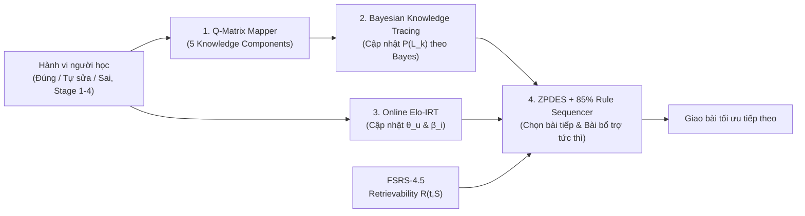

# SEED — Kiến trúc AI Thích ứng Chạy Nền (Background Adaptive Tutoring Engine)

> **Mục tiêu:** Thay vì một chatbot LLM chỉ trả lời thụ động và tốn chi phí API, SEED vận hành một **hệ thống AI sư phạm chạy nền (zero-latency, xác định, giải thích được)** dựa trên các công trình bình duyệt hàng đầu từ **IEEE Transactions on Learning Technologies**, **Nature Communications**, **Journal of Educational Data Mining (JEDM)**, **Computers & Education** và **ACM SIGKDD**.

---

## 1. Danh mục công trình khoa học nền tảng

| Tầng mô hình | Bài báo khoa học & Tác giả | Vai trò trong SEED |
|---|---|---|
| **Chẩn đoán Nhận thức & Q-Matrix** | **Zhao, G., Huang, Z., et al. (2024).** *A Diffusion-Based Cognitive Diagnosis Framework for Robust Learner Assessment.* **IEEE Transactions on Learning Technologies**, Vol. 17, p. 2227. | Ánh xạ từng bài tập vào ma trận kỹ năng (**Q-Matrix** gồm 5 Knowledge Components chuyên biệt cho người Việt học tiếng Hàn) để chẩn đoán chính xác lỗ hổng nào đang yếu. |
| **Truy vết Kiến thức (BKT)** | **Corbett, A. T., & Anderson, J. R. (1995).** *Knowledge tracing: Modeling the acquisition of procedural knowledge.* **UMUAI**, 4(4), 253–278. **Shen, S., Liu, Q., Huang, Z., et al. (2024).** *A Survey of Knowledge Tracing: Models, Variants, and Applications.* **IEEE Transactions on Learning Technologies**, Vol. 17. | Mô hình Markov Ẩn (HMM) cập nhật xác suất thành thạo $P(L_t^{(k)})$ của từng kỹ năng sau mỗi câu trả lời, tách biệt được việc **đoán trúng ($P(G)$)** và **trượt tay ($P(S)$)**. |
| **Ước lượng Năng lực Online (Elo-IRT)** | **Pelánek, R. (2016).** *Applications of the Elo rating system in adaptive educational systems.* **Computers & Education**, Vol. 98, pp. 169–179. | Cập nhật tức thì chỉ số năng lực người học $\theta_u$ và độ khó bài tập $\beta_i$ theo từng lượt làm bài mà không cần huấn luyện batch nặng nề. |
| **Vùng Khó Tối ưu 85%** | **Wilson, R. C., Shenhav, A., Straccia, M., & Cohen, J. D. (2019).** *The Eighty Five Percent Rule for optimal learning.* **Nature Communications**, 10, Article 4646. | Chứng minh toán học rằng tốc độ học đạt cực đại khi tỷ lệ làm đúng duy trì quanh **85%** (tỷ lệ sai ~15.87%). |
| **Điều phối Bandit (ZPDES & RL)** | **Clément, B., Roy, D., Oudeyer, P.-Y., & Lopes, M. (2015).** *Multi-Armed Bandits for Intelligent Tutoring Systems.* **JEDM**, 7(2), 20–48. **Wu, S., Wang, J., & Zhang, W. (2024).** *Contrastive Personalized Exercise Recommendation With Reinforcement Learning.* **IEEE Transactions on Learning Technologies**, Vol. 17, pp. 691–703. | Chọn bài tập tiếp theo nằm đúng **Vùng Phát triển Gần (ZPD)** dựa trên tốc độ tiến bộ thực nghiệm $r_k = \Delta P(L^{(k)})$ thay vì phát bài cứng nhắc theo thứ tự. |
| **Lặp lại Ngắt quãng (FSRS-4.5)** | **Ye, J., Su, J., & Cao, Y. (2022).** *A stochastic shortest path algorithm for optimizing spaced repetition scheduling.* **ACM SIGKDD (KDD '22)**, 4381–4390. | Mô hình hóa đường cong quên **DSR** (Difficulty, Stability, Retrievability) để kích hoạt ôn lại đúng lúc $R(t,S) < 0.90$. |

---

## 2. Kiến trúc 4 Tầng Chạy Nền (Zero-Latency Pipeline)

---

## 3. Ma trận Kỹ năng Q-Matrix cho Người Việt học Tiếng Hàn

Mỗi bài tập trong SEED được ánh xạ tự động vào 1 hoặc 2 **Knowledge Components (KC)**:

| Mã KC | Tên kỹ năng tiếng Việt | Trọng tâm nhận thức |
|---|---|---|
| `kc_phonetics_3way` | Phân biệt 3 bậc phụ âm tắc | Nghe đối chiếu VOT + $f_0$ giữa thường / căng / bật hơi (`ㄱ/ㄲ/ㅋ`, `ㄷ/ㄸ/ㅌ`, `ㅂ/ㅃ/ㅍ`). |
| `kc_phonetics_vowel_batchim` | Nguyên âm & Patchim `ㄴ/ㄹ` | Phân biệt `ㅗ/ㅓ`, `ㅡ/ㅜ`, `ㅐ/ㅔ`, âm cuối `ㄴ/ㄹ`, trung hòa patchim và nối âm `연음`. |
| `kc_morph_particles` | Trợ từ & Biến đổi Patchim | Chia `은/는`, `이/가`, `을/를`, `이에요/예요`, `(으)로` chống lỗi bỏ quên của tiếng Việt. |
| `kc_lexicon_hanja` | Từ vựng & Cầu nối Hán–Việt | Nhận diện nghĩa từ vựng, cụm Hán–Việt (`학`, `국`, `원`) và tránh từ lệch nghĩa. |
| `kc_productive_orthography` | Chính tả & Sản sinh Hangul | Ghép jamo, gõ bàn phím 2-beolsik, sắp xếp trật tự câu SOV và viết câu cá nhân. |

---

## 4. Đặc tả Toán học Cài đặt trong `adaptive-ai.ts`

### 4.1 Bayesian Knowledge Tracing (Corbett & Anderson, 1995; Shen et al., IEEE TLT 2024)
Với mỗi KC $k$ có xác suất thành thạo hiện tại $P(L_{t-1}^{(k)})$:
- **Hiệu chuẩn tham số theo Nấc bài tập:**
  - Nấc 1 (Nhận diện trắc nghiệm): $P(G) = 0.25,\; P(S) = 0.08,\; P(T) = 0.14$
  - Nấc 2 (Ngữ cảnh): $P(G) = 0.20,\; P(S) = 0.10,\; P(T) = 0.18$
  - Nấc 3 (Ghép câu/âm tiết): $P(G) = 0.10,\; P(S) = 0.12,\; P(T) = 0.22$
  - Nấc 4 (Tự gõ/nói chủ động): $P(G) = 0.03,\; P(S) = 0.14,\; P(T) = 0.26$
- **Cập nhật hậu nghiệm (Bayes):**
  $$P(L \mid \text{đúng}) = \frac{P(L)(1 - P(S))}{P(L)(1 - P(S)) + (1 - P(L))P(G)}, \qquad P(L \mid \text{sai}) = \frac{P(L)P(S)}{P(L)P(S) + (1 - P(L))(1 - P(G))}$$
- **Bước chuyển tiếp học tập:**
  $$P(L_t) = P(L \mid \text{obs}) + (1 - P(L \mid \text{obs})) \cdot P(T)$$

### 4.2 Online Elo-IRT & Quy tắc 85% (Pelánek, 2016; Wilson et al., Nature Communications 2019)
- Xác suất làm đúng dự đoán trên bài tập $i$ có độ khó $\beta_i$:
  $$\hat{P}_{u,i} = \frac{1}{1 + e^{-0.008(\theta_u - \beta_i)}}$$
- Hệ số cập nhật giảm dần theo số lượt đã làm $n$ (**Pelánek uncertainty decay**):
  $$K(n) = \frac{40}{1 + 0.08 \cdot n}$$
- Cập nhật đồng thời năng lực người học $\theta_u$ và độ khó bài tập $\beta_i$ (với điểm thực tế $y \in \{0,\; 0.65\text{ (tự sửa)},\; 1.0\}$):
  $$\theta_u' = \theta_u + K(n_u)(y - \hat{P}_{u,i}), \qquad \beta_i' = \beta_i - 0.35 \cdot K(n_i)(y - \hat{P}_{u,i})$$
- **Hàm thưởng Vùng Khó Tối ưu 85% (Wilson et al., 2019):**
  $$\text{ZoneScore}(\hat{P}_{u,i}) = \exp\left(-\frac{(\hat{P}_{u,i} - 0.85)^2}{2 \cdot 0.12^2}\right)$$

### 4.3 Bộ Chọn bài Đa mục tiêu ZPDES + FSRS + BKT + 85% Rule
Khi lập lịch **Phiên học Thích ứng** hoặc **Can thiệp Bổ trợ (Remedial Scaffolding)** giữa bài học khi người học sai:
$$\text{Score}(i) = 0.35 \cdot (1 - R_{\text{FSRS}}(i)) + 0.30 \cdot \max_{k \in Q(i)}(1 - P(L^{(k)})) + 0.25 \cdot \text{ZoneScore}(\hat{P}_{u,i}) + 0.10 \cdot \text{LearningProgress}(Q(i))$$

Nhờ công thức này:
1. Nếu người học làm sai một câu khó ở Nấc 3–4 (`grade = 1`), AI lập tức chèn **1 bài tập bắc cầu (remedial scaffold)** cùng KC ở Nấc thấp hơn gần vùng 85% trước khi cho làm lại câu đã sai — đúng nguyên lý Vùng Phát triển Gần (ZPDES).
2. Khi người học tiến bộ, $\theta_u$ tăng lên → AI tự động đẩy dần các bài Nấc 3–4 vào vùng tối ưu 85%, ngăn chặn tình trạng lặp mãi câu dễ như Duolingo.
